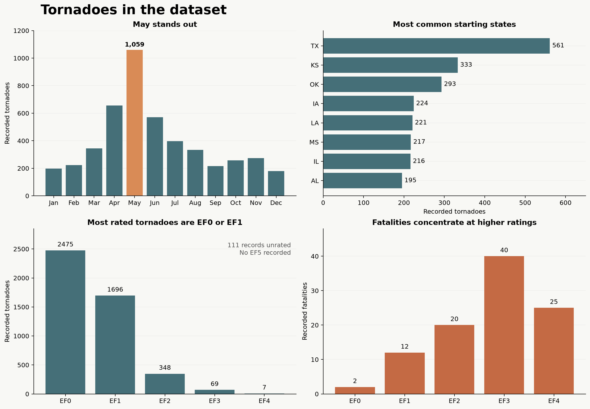

# Tornado EDA

A short exploratory look at 4,706 recorded tornado tracks from 2015–2018, using the cleaned dataset from the STAT 386 EDA Day 1 materials.



## What stands out

- May had 1,059 tornadoes, about 23% of the four-year total. April through June accounted for nearly half.
- Texas had the most tracks assigned to it by starting state (561), followed by Kansas (333) and Oklahoma (293). These counts are not adjusted for state area or population.
- Of the 4,595 tornadoes with known ratings, 4,171 (91%) were EF0 or EF1. Another 111 had unknown ratings.
- The 76 EF3 and EF4 tracks accounted for 65 of the 99 recorded fatalities. Only seven tracks were EF4, so individual events can strongly influence that group's total.
- The median recorded path length was 1.48 miles; the longest was 82.53 miles.

These figures describe this historical four-year snapshot, not long-term trends or individual risk. EF is a damage-based rating associated with estimated winds, not a direct wind measurement. The starting-state field does not count every state a track may have affected.

## Data and preparation

`data/tornadoes.csv` contains one row per whole tornado track. NOAA's [Storm Prediction Center severe weather database](https://www.spc.noaa.gov/wcm/#data) is the original publisher. The STAT 386 teaching materials obtained annual snapshots from [this mirror](https://github.com/gabrielodom/PHC6701_r4ds/tree/main/_data/purrr_example_data), retained whole-track records (`sg == 1`), removed one exact duplicate, and converted unknown EF ratings to missing values. The cleaned file is from [EDA Day 1 Materials](https://github.com/tjkerby/EDA_Day1_Materials). The snapshot may differ from later NOAA revisions. Credit NOAA/SPC when reusing it.

Fields include date, starting state, EF rating, track length and width, coordinates, injuries and fatalities. Start times use Central Standard Time throughout, not each tornado's local clock. The [SPC database description](https://www.spc.noaa.gov/wcm/data/SPC_severe_database_description.pdf) provides background on the original fields.

## Recreate the graph

With Python 3 installed, run from the repository root:

```sh
python -m pip install -r requirements.txt
python scripts/plot_tornadoes.py
```

The script reads `data/tornadoes.csv` and writes `figures/tornado_eda.png`.

Project tracking: [Tornado EDA project](https://github.com/jamesebrandt/TornadoEDA/issues/1).
